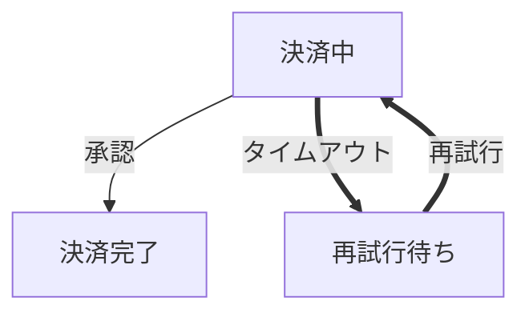
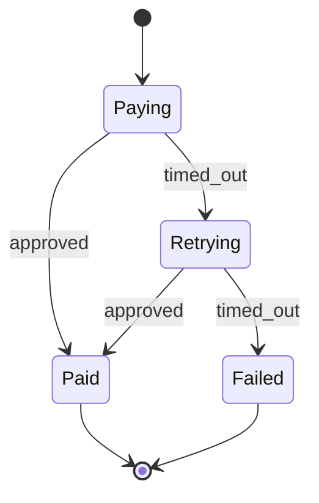

# specforge

specforge は、Markdown に書いた Mermaid の状態図から、「決済の再試行が続くと注文がいつまでも終わらない」といった設計上の見落としを見つけます。



図は、決済と在庫確保を並行して進める注文処理から、決済の部分だけを抜き出したものです。在庫を確保でき、決済も承認されれば注文は完了します。ところが、決済がタイムアウトし続けると、処理は太い矢印に沿って同じ二つの状態を行き来します。在庫は確保できていても、注文の結果は決まりません。

specforge では、図と同じ Markdown に「注文処理はいつか終了する」という条件を書けます。`verify` を実行すると、モデル検査器の TLC が仕様上で起こり得る状態の変化を探索し、条件に反する経路（**反例**）があるかを調べます。

自分のプロジェクトで Claude Code や Codex を使っている方は、[振る舞い仕様を書くスキルをインストール](#既存のコードから始める)して、手元のコードから始められます。

## 注文のサンプルで試す

リポジトリをクローンし、そのディレクトリでコマンドを実行します。

```bash
git clone https://github.com/daikichiba9511/specforge.git
cd specforge
```

Nix を使っている場合は、`nix develop` を実行すると、Bun、Java、TLC がそろいます。

<details>
<summary>Bun と Java を自分で用意する場合</summary>

specforge は Bun で動きます。図の構文や名前の参照は Bun だけで調べられます。モデル検査まで実行するには Java と、TLC を収録した `tla2tools.jar` も必要です。Bun と Homebrew を導入済みの macOS では、次のコマンドで用意できます。

```bash
brew install openjdk
mkdir -p ~/.local/share/specforge
curl -fL https://github.com/tlaplus/tlaplus/releases/download/v1.7.4/tla2tools.jar \
  -o ~/.local/share/specforge/tla2tools.jar
```

ほかの環境では `JAVA_HOME` に JDK のディレクトリを指定します。JAR を別の場所に置いた場合は、そのファイルのパスを `SPECFORGE_TLA_JAR` に設定してください。

</details>

まず、決済を何度でも再試行できる仕様を検査します。

```bash
bun run verify --strict examples/parallel-order-retry.md
```

このコマンドは `Error: Temporal properties were violated.` と表示して終了コード 1 を返します。「反例（仕様上の遷移）」には、決済が次の二つの矢印を繰り返せることと、どの手順の直後に戻るかが示されます。

```text
決済中 --payment_timed_out--> 決済再試行中
決済再試行中 --retry_started--> 決済中
```

この経路では「注文処理はいつか終了する」という条件が成立しません。図の構文や名前の参照を調べる静的検査には通ります。[再試行に上限のない仕様](./examples/parallel-order-retry.md)

次に、再試行を一回に限った仕様を同じ条件で検査します。二回目もタイムアウトしたら、そこで決済を打ち切ります。在庫確保が終われば、注文処理は失敗を返して終了します。

```bash
bun run verify --strict examples/parallel-order-retry-fixed.md
```

今度は `verified ok` と表示されます。TLC はこのモデルで到達できる 16 の状態をすべて調べました。決済に失敗した場合も含め、処理が終わらない経路は見つかりませんでした。[再試行を一回に限った仕様](./examples/parallel-order-retry-fixed.md)

## 自分の仕様を書く

どんな出来事で状態が変わり、処理がどう終わるかを記述したものが**振る舞い仕様**です。まずは、注文処理のうち「決済は成功か失敗のどちらかで終わる」ことだけを確かめてみましょう。



矢印に付いた `approved` や `timed_out` は、状態が変わるきっかけです。`Paid --> [*]` と `Failed --> [*]` は処理の終了を表します。`<>Terminated` は、状態とその変化を記述する言語 TLA+ で「いずれ終了状態に到達する」という意味です。このように、期待することがいつか起きる性質を**進行性**と呼びます。

<details>
<summary><code>payment.md</code> に保存する Markdown を表示</summary>

````markdown


### 進行性

| 性質の名前  | TLA+式       |
| ----------- | ------------ |
| Termination | <>Terminated |
````

</details>

上の Markdown を `payment.md` として保存し、次のコマンドで検査します。

```bash
bun run verify --strict payment.md
```

条件によって行き先が変わるときは、矢印に `event [guard] / action` と書けます。`guard` は遷移を許す条件、`action` はそのときに行う処理です。たとえば自販機の仕様では、商品を選んだときに残高が足りている場合だけ、払い出しに進みます。[自販機の仕様](./examples/vending-machine.md) · [振る舞い仕様の書き方](./docs/writing-specs.md)

### 検査結果の読み方

| 確かめたいこと                   | 使うコマンド                             | 結果の見方                                                                     |
| -------------------------------- | ---------------------------------------- | ------------------------------------------------------------------------------ |
| 状態図と表の記述が整合しているか | `bun run cli --json --strict payment.md` | 未定義のガードや、平坦な図で初期状態からたどり着けない状態などを指摘します。   |
| 処理が途中で行き詰まらないか     | `bun run verify --strict payment.md`     | 終了前にどの遷移も選べなくなる状態（デッドロック）があるかを調べます。         |
| 処理がいつか終了するか           | 同じ `verify` コマンド                   | 「進行性」の表で終了条件を宣言すると、動き続けても終了しない経路まで調べます。 |

`--strict` を付けると、静的検査で指摘が一つでもあれば終了コード 1 が返ります。モデル検査で TLC が反例を返した場合は、違反に至る経路を仕様の状態名とイベント名で表示します。

`verified ok` が示すのは、図と表から作ったモデルでの結果です。残高や件数を使う仕様では、たとえば `--bound=3` と指定すると、検査する値の範囲は 0 から 3 になります。進行性の検査では、処理を進められる状態が続けば、いずれかの遷移がいつか実行されると仮定します。[検査の前提と公平性](./docs/concepts.md)

## 既存のコードから始める

`spec-behavior` を一度インストールすると、**自分のプロジェクトを開いたまま** Claude Code や Codex に振る舞い仕様の作成、抽出、レビューを依頼できます。Bun が使える環境なら、任意のディレクトリで次のコマンドを実行してください。

```bash
bunx --bun skills add daikichiba9511/specforge --skill spec-behavior --global --agent claude-code codex
```

`--global` は、スキルをユーザー単位でインストールする指定です。すでに同名の個人スキルを使っている場合は、コマンドに `--rename specforge-behavior` を加えると、このリポジトリ版を別名で呼び出せます。

インストール後は、調べたいプロジェクトで新しいセッションを開きます。標準の名前でインストールした場合、Claude Code では次のように依頼します。Codex では先頭を `$spec-behavior` に置き換えてください。

```text
/spec-behavior このプロジェクトの注文処理から、振る舞い仕様を書き出して。
決済がタイムアウトした後の再試行と、最終的に注文がどうなるかを知りたい。
根拠となるコードを示し、実際の振る舞いも仕様と照合して。
```

specforge 自身の `verify` 関数から仕様を起こした例では、二種類の失敗が見えてきました。TLC が異常終了したときは、`verify` が失敗を表す値を返します。Java プロセスの起動時に例外が発生したときは、その例外が呼び出し元に伝わります。

照合テストでは、ファイル操作やプロセス起動をテスト用の関数に置き換えて `verify` を呼びます。この二種類の失敗を含む 10 通りのケースで、呼び出しの順序と結果が仕様に合うことを確かめています。[抽出した仕様](./docs/verify-execution.md) · [実装との照合テスト](./tests/verify-execution.test.ts)

書き出した仕様を TLC で検査する場合は、[specforge の実行ファイル](#単体の実行ファイルを作る)と Java、`tla2tools.jar` を別途用意します。実行ファイルにパスを通せば、自分のプロジェクトのターミナルで `specforge verify --strict payment.md` のように実行できます。[スキルの使い方](./.agents/skills/spec-behavior/SKILL.md)

## ほかの形式で使う

`verify` は状態図を TLA+ に変換して TLC に渡します。モデルを手元で読みたいときは `--tla` で書き出せます。並行する処理のイベント列を表す CSPm 形式で出力するには、形式を指定せずに実行します。CSPm の検査には別途 FDR4 を使います。

```bash
bun run cli --tla --bound=3 examples/vending-machine.md > Spec.tla
bun run cli examples/vending-machine.md > Spec.csp
```

### Quintでシナリオを実行する

Quint では、操作を順に並べてモデルの動きをテストできます。次の例では、自販機の仕様を Quint のモデルに変換し、「コインを入れて返金を求める」「コインを入れ、商品を選んで受け取る」という二つのシナリオを試します。

```bash
bun run cli --quint --strict --bound=3 examples/vending-machine.md > examples/quint/Spec.qnt
bunx --bun --package @informalsystems/quint@0.34.0 quint test examples/quint/vending-tests.qnt \
  --backend=typescript --max-samples=20 --seed=0x42
```

「投入待ちに戻ったら残高は必ずゼロか」も試せます。次のコマンドはモデル上で操作を繰り返し、この条件に反する状態を探します。

```bash
bunx --bun --package @informalsystems/quint@0.34.0 quint run examples/quint/Spec.qnt \
  --backend=typescript --invariant='phase != "Idle" or state_balance == 0' \
  --seed=0x42 --max-samples=100 --max-steps=6 --out-itf=refund.itf.json
```

この例では反例が見つかり、操作に伴う状態の変化が `refund.itf.json` に保存されます。返金の矢印をたどると投入待ちに戻りますが、矢印に書いたアクション名 `return_all` だけでは、モデルの残高はゼロに戻りません。このコマンドでは 1 回につき最大 6 ステップ、最大 100 回まで試し、反例が見つかった時点で止まります。状態の入れ子、並列処理、進行性を含む仕様には `verify` を使います。

## 単体の実行ファイルを作る

`bun run compile` で、その環境向けの実行ファイル `bin/specforge` を作れます。Bun も組み込まれるので、実行ファイルをパスの通った場所に置けば `specforge verify --strict payment.md` のように使えます。TLC を使う環境には Java と JAR も用意してください。

## specforge 本体を開発する

リポジトリのルートで次のコマンドを実行します。`mise install` を使うと、開発用の Bun と OpenJDK 21 をそろえられます。

```bash
bun install --frozen-lockfile
bun run test
bun run fmt:check
bun run lint
bun run check
```

## さらに詳しく

- [サンプル集](./examples/README.md)には、注文処理のほか、接続プールや並行処理の例があります。
- [振る舞い仕様の考え方](./docs/behavior-specs.md)と[基本概念](./docs/concepts.md)では、仕様に含める範囲の決め方と、モデル検査で確かめられる性質を説明しています。
- [入力仕様](./docs/spec.md)と[遷移ラベルの読み方](./docs/label-reading.md)では、使える Mermaid 記法、表の書式、各形式への変換規則を確認できます。
- specforge 本体については、[CLI の振る舞い仕様](./docs/behavior.md)、[設計判断](./docs/decisions.md)、[性能計測](./docs/perf.md)、[残タスク](./tasks/todo.md)を参照してください。
