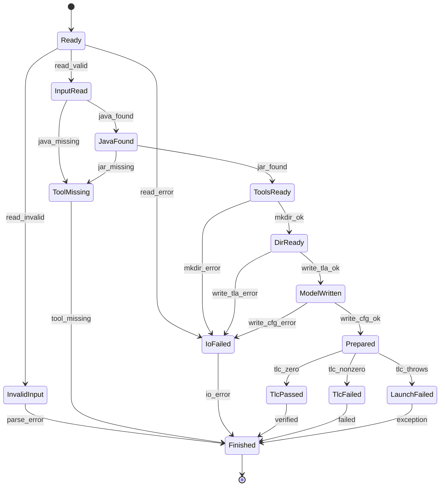

# verify が TLC を実行するまでの振る舞い

対象は [`verify` 関数](../src/verify.ts) の一回の呼び出しである。入力ファイルの読み取り、Java と JAR の探索、一時ファイルの書き込み、TLC の起動を、呼び出し元から見た終了結果に結びつける。CLI による引数の処理と事前の静的検査は [CLI 全体の仕様](./behavior.md) にある。

## 観測する順序

図のイベントは、同期呼び出しの結果を順番に記録したものである。`read_valid` と `read_invalid` は読み取った内容を構文で分類する。最後のイベントは `verify` の戻り値の `kind`、または呼び出し元に伝わった例外を表す。



## 根拠と検査範囲

| 観測点                     | 実装上の根拠                                                                                                                                                                      |
| -------------------------- | --------------------------------------------------------------------------------------------------------------------------------------------------------------------------------- |
| 読み取りからツール探索まで | `verify` は `readFile` の例外を `io_error` にする。読めた入力を `preprocess` と `parse` に渡し、構文エラーならツールを探す前に返る。                                              |
| Java、JAR の探索           | `findJava`、`findTlaJar` の順で呼ぶ。どちらか一方が見つからない時点で `tool_missing` を返す。                                                                                     |
| 一時ファイルの準備         | `makeTempDir` のあと、`writeFile` で `Spec.tla`、`Spec.cfg` の順に書く。どこで失敗しても `io_error` を返す。                                                                      |
| TLC の実行と終了           | `defaultRunTlc` はプロセスの起動エラーを投げる。`verify` は `runTlc` の例外を呼び出し元に伝える。プロセスが終了した場合は終了コード 0 が `verified`、それ以外が `failed` になる。 |

一回の呼び出しは直列であり、途中で失敗した操作を再試行しない。図にない順序をテストで観測した場合は不一致として扱う。外部処理は応答を返すか、図にある例外を投げると仮定する。OS の待ち時間、生成ファイルの内容、TLC 内部の探索はこの図の対象外である。

既存の CLI 仕様では、TLC の起動失敗も `tlc_failed` として要約する。実装をたどると、Java プロセスを起動する際に `runTlc` が投げた例外は `verify` と CLI の `finalizeVerify` を通過する。この場合は通常の失敗要約を返す処理に到達しない。図ではこの経路を `tlc_throws` として残した。

## 再現する

```bash
bun run cli --strict --json docs/verify-execution.md
bun run verify --strict docs/verify-execution.md
bun test tests/verify-execution.test.ts
```

二つ目のコマンドは、図から生成した有限モデルでデッドロックを調べる。三つ目は [実装との照合テスト](../tests/verify-execution.test.ts) を実行する。外部依存をテスト用に置き換え、実際の `verify` が呼んだ操作、その順序、呼び出し元が受け取った結果を図の遷移と突き合わせる。
